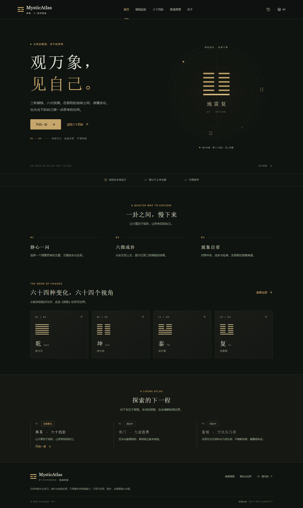

# MysticAtlas · 易境

An open atlas of the I Ching by **XichuGeek / 西楚极客**. Deterministic rules, classical Chinese sources, and space for personal reflection.

[简体中文](README.zh-CN.md) · [Sources](docs/SOURCES.md) · [Architecture](docs/ARCHITECTURE.md) · [Release evidence](docs/RELEASE_REPORT.md)



For cultural learning, entertainment and self-reflection. **No scientific predictive power. Do not use readings for investment, medical, legal or other major decisions.** No accounts, payments, fate scores or paid remedies.

## V1 features

- Three animated coins, six explicit incremental casts; skip animation, undo and restart. Browser Web Crypto supplies randomness.
- Manual entry using line values (6/7/8/9) or individual coin faces (2/3).
- Primary, transformed and nuclear hexagrams; moving line positions, trigrams, raw values and rule version.
- Search/filter all 64 hexagrams and 384 line statements, pinned source links and disclosed textual variants.
- Chinese/English core UI, keyboard controls, reduced-motion preference and responsive layouts.
- Explicit local journal save, optional local theme save, JSON export and clear. Theme-free clipboard sharing.
- Optional server-only AI adapter; structured, source-checked output and graceful fallback. **AI is disabled by default.**

English navigation and explanations are provided. Classical texts remain in Chinese; short English labels are not a translation. Future Qimen and face-geometry modules are marked Planned and are not implemented.

## Run locally

Requires Node **22.12+**. From the project directory:

```sh
npm ci
npm run dev
```

Open [localhost:3000](http://localhost:3000). No `.env`, key, database or paid service is required. Development binds loopback by default. For a production build:

```sh
npm run build
npm start
```

`npm start` reads an optional ignored `.env`; see `.env.example`. Use `HOST=0.0.0.0` only when intentionally exposing the service. Browser cryptographic randomness requires a secure context (localhost or HTTPS).

```sh
docker compose up --build -d --wait
docker compose down
```

Compose also uses loopback port 3000. Set `MYSTICATLAS_PORT=3001` in your private `.env` if it is occupied. Do not run the dev server and Compose on the same port. No server volume is needed. Full deployment/rollback instructions are in [DEPLOYMENT](docs/DEPLOYMENT.md).

## Optional AI

Copy `.env.example` to `.env`, explicitly set `AI_ENABLED=true`, and configure `AI_BASE_URL` (HTTPS, OpenAI-compatible `/v1` base), `AI_API_KEY` and `AI_MODEL`. Restart the service. Keys stay server-side. A ChatGPT or Codex subscription does **not** provide public-site API credit.

The configured provider receives the chart and optional theme only after the user presses Request AI. The app does not log themes. Concurrency, timeout, request rate, output tokens and per-process request budget are configurable. The budget resets on process restart: also set a hard provider-side spending cap. Public demos should keep AI disabled until provider privacy, budget and durable quota policy are reviewed. Tests use an explicitly mocked provider; real AI is not verified in this delivery.

## Verify

```sh
npm run format:check
npm run check
npx playwright install chromium
npm run test:e2e
npm audit --audit-level=high
npm run test:distribution
```

The engine tests exhaust all **4096** six-line inputs against independently extracted pair mappings and explicit truth tables. Eight fair coin combinations prove exact 1/3/3/1 weights. The 100,000-cast distribution report is diagnostic only, never a flaky statistical CI gate. E2E uses real Chromium desktop/mobile emulation; it does not claim physical-device or Safari testing. See [RELEASE_REPORT](docs/RELEASE_REPORT.md) for actual executed results and evidence paths.

## Sources and license

Original code and CSS/SVG: MIT. Public-domain Zhouyi core text is imported from a pinned MIT data arrangement; an independently downloaded CC0 classical corpus verifies all 64 trigram pairs. Both are digital transcriptions, not authoritative critical editions. 18 line-text differences are retained and labeled pending review; judgments have not undergone full critical collation. [SOURCES](docs/SOURCES.md), [THIRD_PARTY_NOTICES](THIRD_PARTY_NOTICES.md) and exact upstream license files describe the limits. No unlicensed modern translations, stock assets or remote fonts are included.

## Repository and deployment status

Target repository: [xichugeek/MysticAtlas](https://github.com/xichugeek/MysticAtlas). Local work only; no public push has been performed. Proposed demo `mysticatlas.demo.xichugeek.com` is **not deployed**. Forge, DNS/TLS, production routing and sleep/wake behavior remain unverified and require separately authorized environment inspection. GitHub Actions is supplied, but no remote workflow run is claimed.

## Contributing and roadmap

See [CONTRIBUTING](CONTRIBUTING.md). V1 focuses on the Zhouyi. V2 Qimen requires separately verified calendar and chart rules. V3 may explore cultural sources and face geometry only, without inferring identity, personality, intelligence, health, wealth, marriage or fate. Do not add predictive claims or automated high-stakes advice.
